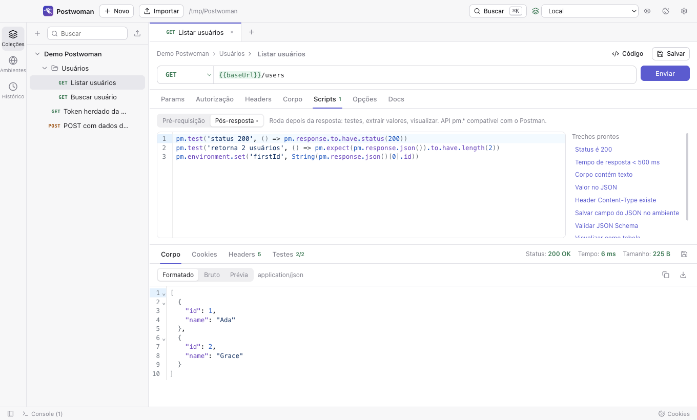
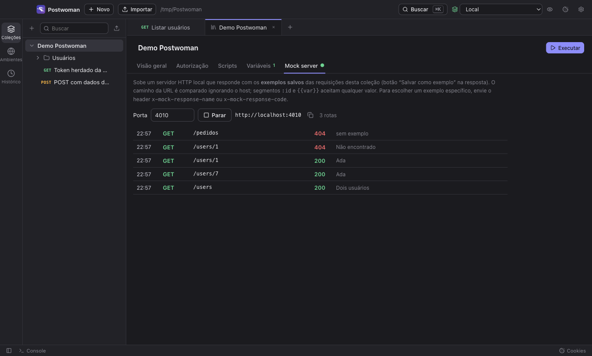
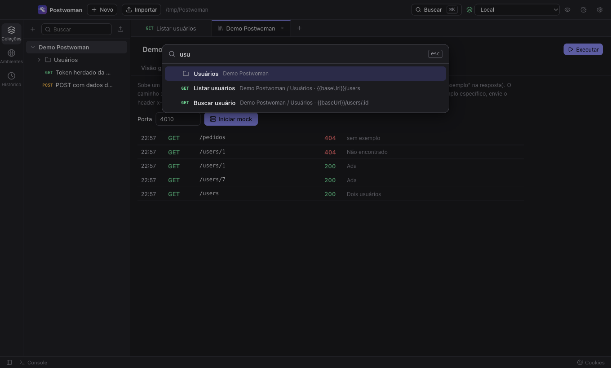

<p align="center"></p>

<h1 align="center">Postwoman</h1>

<p align="center">
  Cliente de APIs desktop, <b>local</b> e <b>open source</b>, que abre suas coleções do Postman.<br>
  Sem conta, sem nuvem: tudo fica em arquivos na sua máquina e pode ir para o git.
</p>

<p align="center">
  <a href="https://github.com/netoonine/postwoman/actions/workflows/ci.yml"></a>
  <a href="https://github.com/netoonine/postwoman/releases"></a>
  <a href="LICENSE"></a>
  <a href="CONTRIBUTING.md"></a>
</p>

<p align="center"></p>

> 🇺🇸 **English:** Postwoman is a free, local-first, open source desktop API client (Electron) that opens Postman collections as-is. HTTP, GraphQL, WebSocket, Socket.IO, MQTT and gRPC, `pm.*` scripts, collection runner, CLI for CI, and a local mock server. Docs are in Portuguese for now; issues and PRs in English are welcome.

## Por que

- **Seus dados são arquivos.** Coleções e ambientes ficam no formato Postman v2.1 numa pasta sua. Dá para versionar no git, revisar em PR e abrir no Postman.
- **Segredos não vazam para o git.** Variáveis do tipo _secreto_ ficam no Keychain do sistema; o arquivo guarda só o nome.
- **Mesmo motor do Postman.** Usa o `postman-runtime` (open source), então scripts `pm.*`, testes e herança de autenticação funcionam igual.
- **Roda no CI.** A CLI `postwoman run` executa as coleções e gera relatórios JUnit e JSON.

## Instalar

Baixe a versão para o seu sistema em **[Releases](https://github.com/netoonine/postwoman/releases)**:

| Sistema | Arquivo |
| --- | --- |
| macOS (Apple Silicon / Intel) | `Postwoman-x.y.z-mac-arm64.dmg` / `-mac-x64.dmg` |
| Windows | `Postwoman-x.y.z-win-x64.exe` |
| Linux | `.AppImage` ou `.deb` |

Os instaladores ainda **não são assinados**, então o sistema avisa na primeira vez:

- **macOS:** se aparecer "Postwoman está danificado" ou "não pode ser aberto", rode `xattr -cr /Applications/Postwoman.app` no Terminal e abra de novo.
- **Windows:** no aviso do SmartScreen, clique em _Mais informações_ → _Executar assim mesmo_.

## O que tem

- **HTTP**: params, path variables (`/users/:id`), headers, corpo raw (JSON/XML/HTML/texto), form-data com arquivos, urlencoded, binário e GraphQL
- **Autenticação**: Basic, Bearer, API Key, JWT, Digest, OAuth 1.0, OAuth 2.0 (authorization code, PKCE, implicit, password, client credentials), Hawk, AWS Signature, NTLM e Akamai EdgeGrid, com herança de pasta e coleção
- **Scripts** pré-requisição e pós-resposta com a API `pm.*` (testes, variáveis, `pm.sendRequest`, visualizer)
- **Coleções, pastas, ambientes**, variáveis globais e de coleção, com `{{variáveis}}` destacadas e autocompletar
- **Runner** com iterações, intervalo e arquivo de dados CSV/JSON
- **CLI** para terminal e CI (`postwoman run`, relatórios JUnit/JSON)
- **Mock server local** que responde com os exemplos salvos
- **Busca rápida** (⌘K / Ctrl+K) em requisições, ambientes e comandos
- **Geração de código**: cURL, fetch, axios, Python, Go, Java, C#, PHP, Ruby, Swift e outros
- **Importação** de coleções Postman v1/v2.0/v2.1, ambientes, backup completo do Postman, OpenAPI 3 / Swagger 2 e cURL (colar um cURL na barra de URL também funciona)
- **Tempo real**: WebSocket, Socket.IO, MQTT e gRPC (server reflection ou `.proto`, unário e streaming)
- **Rede**: proxy manual, proxy do sistema, CA própria e certificados de cliente (mTLS)
- **Sincroniza com o disco**: um `git pull` na pasta de trabalho aparece no app na hora
- Cookies persistentes, histórico, console e tema claro/escuro

<p align="center">
  
  
</p>

## CLI

A CLI usa o mesmo motor do app e roda coleções exportadas do Postman ou do Postwoman.

```bash
# dentro do repositório
npm install && npm run build
npm link            # deixa o comando `postwoman` disponível no terminal

postwoman run minha-api.postman_collection.json -e local.postman_environment.json
postwoman run "Minha API" -w ~/Postwoman -e Produção --env-var token=$API_TOKEN \
  -r cli,junit --reporter-junit-export resultados.xml
postwoman mock "Minha API" -p 4010
postwoman list
```

O código de saída é `0` quando tudo passa e `1` quando algum teste ou requisição falha, então dá para usar direto no CI. `postwoman --help` mostra todas as opções (iterações, dados CSV/JSON, `--folder`, `--bail`, proxy, certificados).

<details>
<summary>Exemplo com GitHub Actions</summary>

```yaml
- uses: actions/checkout@v7
- uses: actions/checkout@v7
  with: { repository: netoonine/postwoman, path: .postwoman }
- run: cd .postwoman && npm ci && npm run build
- run: node .postwoman/bin/postwoman.js run api/minha-api.postman_collection.json -e api/ci.postman_environment.json --env-var token=${{ secrets.API_TOKEN }} -r cli,junit --reporter-junit-export resultados.xml
```

</details>

## Onde ficam os dados

Tudo em arquivos na pasta de trabalho (padrão `~/Postwoman`, trocável em Configurações):

```
collections/<nome>-<id>.postman_collection.json   # formato Postman v2.1, abre no Postman
environments/<nome>-<id>.postman_environment.json
globals.postman_globals.json
cookies.json
history.json
```

Para versionar a pasta com git, coloque `cookies.json` e `history.json` no `.gitignore`. Valores marcados como **secreto** ficam fora dos arquivos, no Keychain (macOS), DPAPI (Windows) ou libsecret (Linux); quem clonar a pasta preenche os próprios valores.

## Desenvolver

Precisa de Node 22 ou mais novo.

```bash
git clone https://github.com/netoonine/postwoman.git
cd postwoman
npm install
npm run dev          # abre o app com recarga automática
```

| Comando | O que faz |
| --- | --- |
| `npm run dev` | app em modo desenvolvimento |
| `npm test` | testes unitários (motor, mock, importador, CLI) |
| `npm run build && npm run test:e2e` | testes ponta a ponta: abre o app e clica pela interface |
| `npm run typecheck` | checagem de tipos |
| `npm run format` | formata o código (Prettier) |
| `npm run dist` | gera o instalador para o seu sistema em `dist/` |
| `npm run test:server` | sobe o servidor de teste em `http://127.0.0.1:4555` para testar na mão |

O `npm install` já baixa o binário do Electron (`postinstall`). Se o app não abrir, rode `npx install-electron`.

Quer ajudar? Leia o **[guia de contribuição](CONTRIBUTING.md)** e procure issues marcadas com [`good first issue`](https://github.com/netoonine/postwoman/labels/good%20first%20issue).

## Arquitetura

```
src/core      motor sem Electron: execução (postman-runtime), mock server, importador, codegen
src/cli       CLI (postwoman run / mock / list), usa src/core
src/main      processo principal do Electron: janela, IPC, pasta de trabalho, cofre de segredos, protocolos em tempo real
src/preload   ponte IPC exposta como window.api
src/renderer  interface React; estado em store.ts (zustand)
src/shared    tipos compartilhados (schema Postman Collection v2.1 + extensão "postwoman")
test/         unitários (vitest), E2E (Playwright + Electron) e servidor de teste
```

Mais detalhes em [CONTRIBUTING.md](CONTRIBUTING.md#como-o-código-está-organizado).

## Aviso

O Postwoman é um projeto independente e **não tem relação com a Postman, Inc.** nem com o [Hoppscotch](https://github.com/hoppscotch/hoppscotch), que usou o nome Postwoman até 2020. "Postman" é marca da Postman, Inc. e aparece aqui só para indicar compatibilidade de formato. A interface é código próprio; do ecossistema Postman são usadas apenas bibliotecas open source publicadas no npm (`postman-runtime`, `postman-collection`, `postman-code-generators`, `openapi-to-postmanv2`, `curl-to-postmanv2`, `postman-collection-transformer`), todas sob licença Apache-2.0.

## Licença

[MIT](LICENSE) © netoonine e contribuidores.
